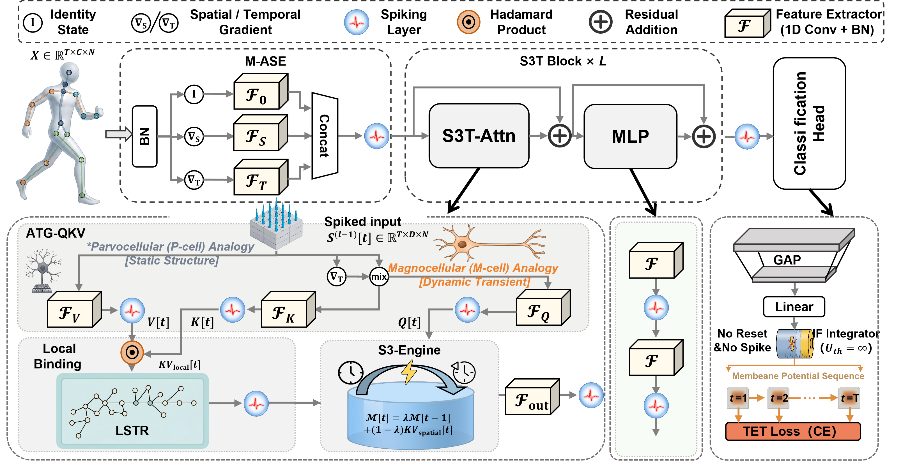

# S3T-Former: A Spike-Driven State-Space Topology Transformer for Skeleton Action Recognition

**Official implementation** of:

> **S3T-Former: A Spike-Driven State-Space Topology Transformer for Skeleton Action Recognition**  
> Preprint

**Authors:** Naichuan Zheng, Hailun Xia, Liwei Bao, Zepeng Sun, Weiyi Li, Peiying Ouyang, Zhendong Yuan

**Abstract (short):** S3T-Former targets skeleton-based action recognition with a **spike-driven** design: native LIF neurons, **state-space** structure for long-range temporal modeling, and **topology-aware** attention that propagates information along the skeleton graph. This codebase supports NTU RGB+D 60/120 and NW-UCLA with multi-stream (joint / bone / motion) configs.

<p align="center">
  
</p>

---

## Table of Contents

- [Installation](#installation)
- [Project Structure](#project-structure)
- [Data Preparation](#data-preparation)
- [Training](#training)
- [Testing and Multi-Stream Ensemble](#testing-and-multi-stream-ensemble)
- [Ablation Configs](#ablation-configs)
- [Model Configuration](#model-configuration)
- [Implementation Notes](#implementation-notes)
- [Citation](#citation)

---

## Installation

```bash
cd S3T-Former/spiking-topo-transformer-code
pip install -r requirements.txt
# optional, for the faster SpikingJelly CUDA backend:
pip install cupy-cuda12x
```

## Project Structure

```
spiking-topo-transformer-code/
├── model/
│   └── spiking_ssm_topo_transformer.py   # S3T-Former (M-ASE, ATG-QKV, LSTR, S3-Engine, U-Readout)
├── feeders/
│   ├── feeder_ntus.py      # NTU RGB+D 60/120 (.npz, 25 joints, 2 persons)
│   ├── feeder_ucla.py      # NW-UCLA (.json, 20 joints, 1 person)
│   ├── bone_pairs.py       # NTU / NW-UCLA bone pairs for the bone streams
│   └── tools.py            # spine-base translation, uniform sampling / padding to T frames
├── graph/                  # skeleton graphs (25-joint NTU, 20-joint NW-UCLA)
├── config/
│   ├── nturgbd-cross-subject-s3t-former.yaml      # main model: NTU60 X-Sub, joint, D=256, T=16
│   ├── nturgbd-cross-subject-s3t-former-*.yaml    # NTU60 X-Sub, four streams, D=384, T=16
│   ├── nturgbd-cross-view-s3t-former-*.yaml       # NTU60 X-View
│   ├── ntu120-cross-subject-s3t-former-*.yaml     # NTU120 X-Sub
│   ├── ntu120-cross-set-s3t-former-*.yaml         # NTU120 X-Set
│   ├── nw-ucla-s3t-former-*.yaml                  # NW-UCLA
│   └── ablation/                                  # Tables 3-5 of the paper
├── train.py                # training and testing (--eval-only)
├── ensemble.py             # J+B+JM+BM score fusion
├── test_model.py           # forward/backward check of all variants on random input
└── requirements.txt
```

## Data Preparation

**NTU RGB+D 60 / 120**: `.npz` files with `x_train`, `y_train`, `x_test`, `y_test` (layout of the common CTR-GCN data pipeline: `x_*` has shape `(N, T, 150)` = 2 persons x 25 joints x 3, `y_*` is one-hot).

| Protocol | File |
|---|---|
| NTU60 X-Sub | `NTU60_CS.npz` |
| NTU60 X-View | `NTU60_CV.npz` |
| NTU120 X-Sub | `NTU120_CSub.npz` |
| NTU120 X-Set | `NTU120_CSet.npz` |

**NW-UCLA**: under `data_path`, the folders `train/` (cameras V1 and V2) and `val/` (camera V3), each with one JSON per sequence, `{"skeletons": ...}` of shape `(T, 20, 3)`. The class id is read from the file name prefix `aXX_...`; alternatively set `label_path` to a JSON list of `{"file_name": ..., "label": 1}` (1-based).

Set `data_path` in `train_feeder_args` and `test_feeder_args` of the config. The feeders apply the preprocessing of the paper (Sec. 4.2): the 3D joint coordinates are translated relative to the spine-base joint, each sequence is uniformly sampled or zero-padded to `T` frames, and no random rotation, scaling, shearing, or additional temporal augmentation is used. The bone (`bone: true`), joint-motion (`vel: true`), and bone-motion (both) streams are derived after this preprocessing.

## Training

All commands are run from `spiking-topo-transformer-code/`. The configs use four GPUs (`device: [0, 1, 2, 3]`, total batch size 64); set `--opts "device=[0]"` for a single GPU.

Main single-stream model (NTU60 X-Sub, joint, `D=256`, `T=16`):

```bash
python train.py --config config/nturgbd-cross-subject-s3t-former.yaml --work-dir logs/ntu60-xsub-j-d256-t16
```

Other rows of Table 1 change `D` and `T` with `--opts`:

```bash
# D=256, T=8 (use 32 for T=32)
python train.py --config config/nturgbd-cross-subject-s3t-former.yaml --work-dir logs/ntu60-xsub-j-d256-t8 \
  --opts train_feeder_args.window_size=8 test_feeder_args.window_size=8
# D=384, joint, T=16
python train.py --config config/nturgbd-cross-subject-s3t-former-joint.yaml --work-dir logs/ntu60-xsub-j-d384-t16
```

For the other protocols, use the corresponding `ntu120-*`, `nturgbd-cross-view-*`, or `nw-ucla-*` config; `--opts model_args.embed_dim=256` selects `D=256`.

Training follows Sec. 4.2: AdamW with a base learning rate of 0.01 and a weight decay of 0.0005, a 10-epoch linear warmup followed by cosine annealing to 1e-5, 250 epochs, automatic mixed precision, and the prefix objective of Eq. (14), which averages the cross-entropy over all prefix logits `z[t]`.

`work_dir` then contains `log.txt`, `config.yaml`, `best_model.pth`, `latest_model.pth`, and `test_scores.npz` (terminal logits `z[T]` of the best epoch).

## Testing and Multi-Stream Ensemble

Inference uses the terminal membrane potential `z[T]` of U-Readout:

```bash
python train.py --config config/nturgbd-cross-subject-s3t-former.yaml --work-dir logs/ntu60-xsub-j-d256-t16 \
  --eval-only --weights logs/ntu60-xsub-j-d256-t16/best_model.pth
```

This writes `test_scores.npz` to `work_dir`. The four-stream model (`All` = J+B+JM+BM in Table 1) trains and tests the four stream configs and fuses their scores:

```bash
python ensemble.py --scores logs/j/test_scores.npz logs/b/test_scores.npz logs/jm/test_scores.npz logs/bm/test_scores.npz
```

`--weights` sets optional per-stream weights (default 1 for every stream).

## Ablation Configs

All ablations use NTU60 X-Sub with the joint-only `D=256`, `T=16` model and change one setting (`config/ablation/`, inheriting the main config through `_base_`):

| Paper | Config | Setting |
|---|---|---|
| Table 3 | `wo_mase.yaml` | w/o M-ASE: joint projection only |
| Table 3 | `wo_atg_qkv.yaml` | w/o ATG-QKV: direct Q/K/V projection |
| Table 3, 5 | `wo_lstr.yaml` | w/o LSTR: identity routing |
| Table 3, 4 | `wo_s3_engine.yaml` | w/o S3-Engine: `O[t] = Q[t] * KV_out[t]` |
| Table 3, 4 | `wo_u_readout.yaml` | spike-count readout, prefix supervision retained |
| Table 4 | `memory_none_spike_count.yaml` | no memory, spike-count readout |
| Table 4 | `s3_fixed_decay.yaml` | S3-Engine with a fixed decay of 0.5 |
| Table 5 | `lstr_learned_only.yaml` / `lstr_physical_only.yaml` | routing with `A_learned` or `A_base` alone |
| Table 5 | `lstr_hybrid_h1.yaml` / `lstr_hybrid_h4.yaml` | hybrid routing with `H=1` / `H=4` |
| Table 5 | `lstr_hybrid_gamma0.1.yaml` / `lstr_hybrid_gamma1.0.yaml` | hybrid routing with `gamma=0.1` / `1.0` |

```bash
python train.py --config config/ablation/wo_s3_engine.yaml --work-dir logs/ablation/wo_s3_engine
```

## Model Configuration

Main keys of `model_args`:

| Key | Default | Meaning |
|---|---|---|
| `embed_dim` | 256 / 384 | embedding dimension `D` |
| `depth` | 6 | number of S3T Blocks `L` |
| `num_heads` | 8 | routing heads `H` |
| `v_threshold`, `leak` | 0.5, 0.5 | LIF threshold `U_th` and leakage factor `tau` (Eq. 1) |
| `surrogate_alpha` | 2.0 | shape parameter of the ATan surrogate gradient |
| `topology_gamma` | 0.5 | scale `gamma` of the learned topology (Eq. 8) |
| `use_mase` | true | M-ASE; false = joint projection only |
| `use_temporal_gradient_qkv` | true | ATG-QKV with Soft-ATG; false = direct Q/K/V projection |
| `lstr_mode` | hybrid | `hybrid`, `learned`, `physical`, or `identity` routing |
| `use_s3_engine` | true | S3-Engine; false = `O[t] = Q[t] * KV_out[t]` |
| `s3_decay_mode` | learnable | `learnable` or `fixed` (`s3_fixed_decay`) |
| `readout` | u_readout | `u_readout` or `spike_count` |

## Implementation Notes

| Paper | Code |
|---|---|
| LIF neuron, Eq. (1): `H[t] = tau U[t-1] + I[t]`, threshold 0.5, hard reset, `tau = 0.5`, ATan surrogate (2.0) | `make_lif` (SpikingJelly `LIFNode`, `decay_input=False`, `tau_sj = 1/(1 - tau) = 2`) |
| M-ASE, Eqs. (2)-(3): identity, temporal-difference, and anatomical-difference streams, each a 1D conv + BN, concatenated and spiked | `AnatomicalSpikingEmbedding` |
| ATG-QKV, Eqs. (4)-(6): `S_grad = abs(S[t] - S[t-1])`, `S_dyn = alpha * S_grad + (1 - alpha) * S`, `alpha = sigmoid(a)` | `S3TAttention.forward` |
| Local binding, Eq. (7): `KV_local = K * V` | `S3TAttention.forward` |
| LSTR, Eqs. (8)-(10): `A_route = Softmax_row(A_base + gamma A_learned)`, buffer LIF | `S3TAttention.routing_matrix`, `build_anatomical_prior` |
| S3-Engine, Eqs. (11)-(12): `lambda = Clamp(sigmoid(w), 0.01, 0.99)`, `M[t] = lambda M[t-1] + (1 - lambda) KV_out[t]`, `O[t] = Q[t] * M[t]` | `s3_engine` |
| S3T Block, Listing 1: output LIF and first residual, Spiking MLP, second residual with `LIF_Residual` | `S3TBlock` |
| U-Readout, Eq. (13): `U_out[t] = U_out[t-1] + I_c[t]`, inference with `z[T]` | `forward_prefix` |
| Prefix objective, Eq. (14) | `prefix_loss` |

---

## Citation

If you use this code or the method in your research, please cite:

```bibtex
@misc{zheng2026s3tformer,
  title={S3T-Former: A Spike-Driven State-Space Topology Transformer for Skeleton Action Recognition},
  author={Zheng, Naichuan and Xia, Hailun and Bao, Liwei and Sun, Zepeng and Li, Weiyi and Ouyang, Peiying and Yuan, Zhendong},
  note={Preprint},
  year={2026}
}
```
